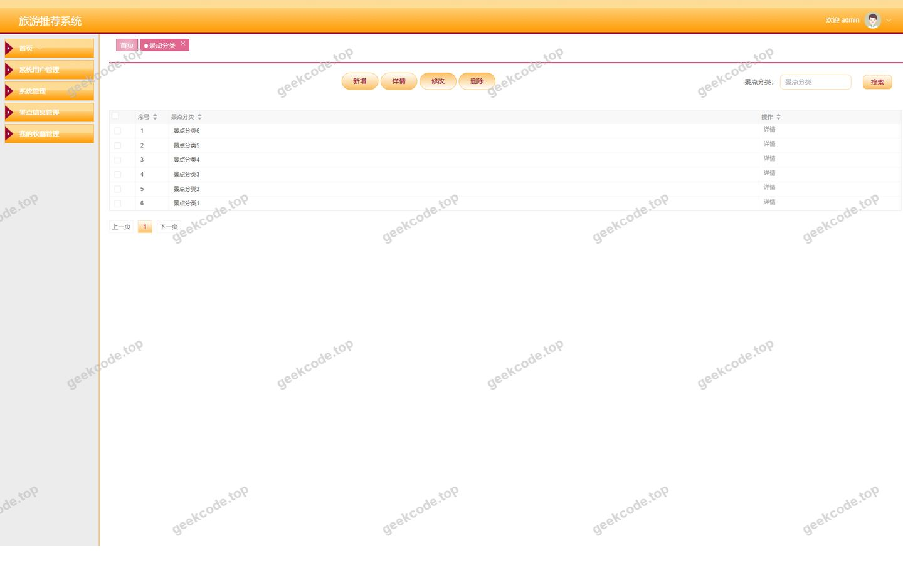
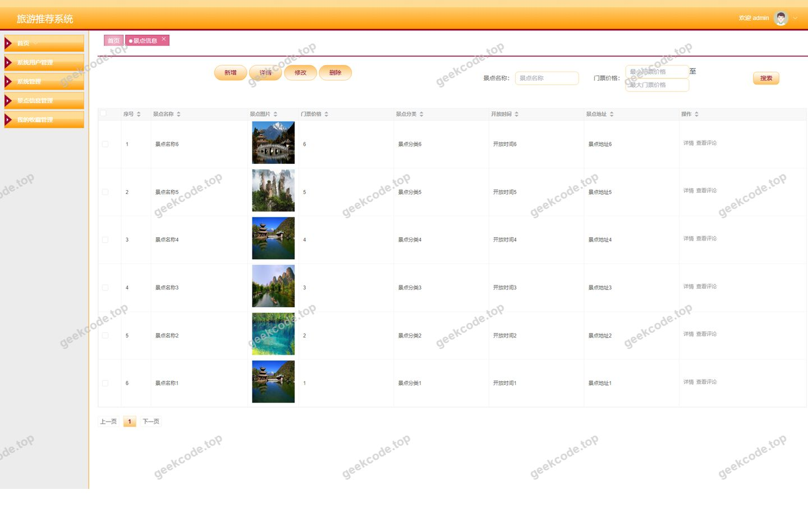
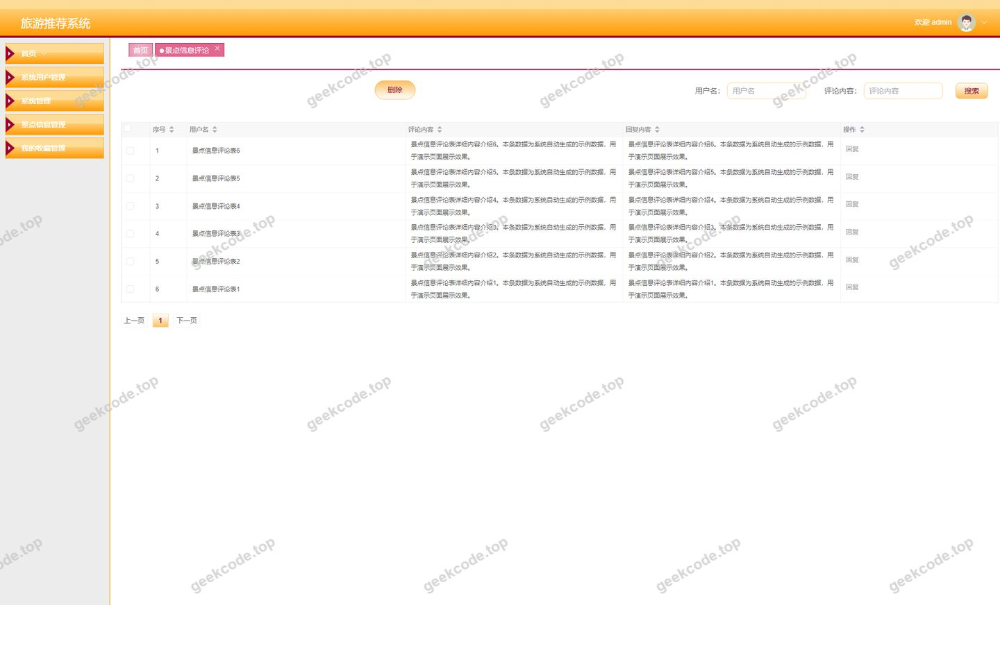
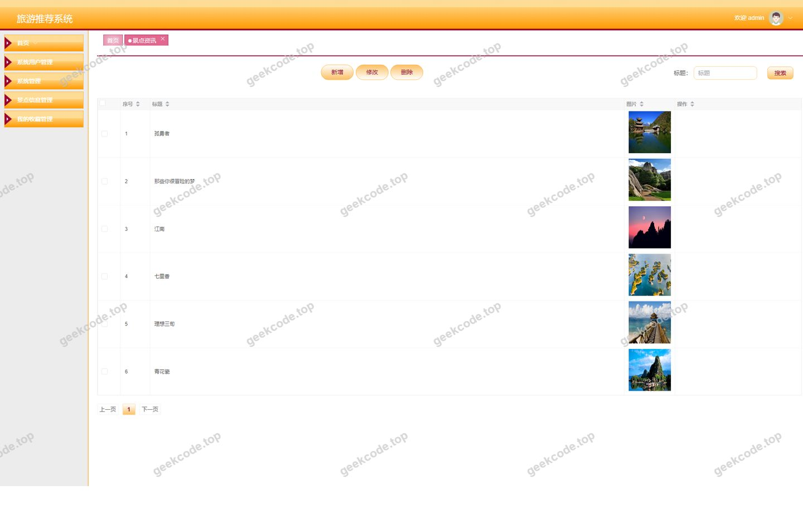
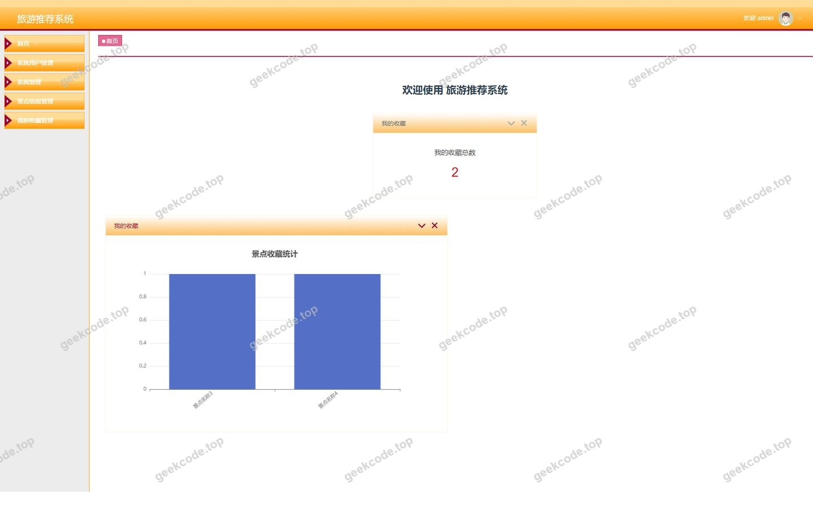
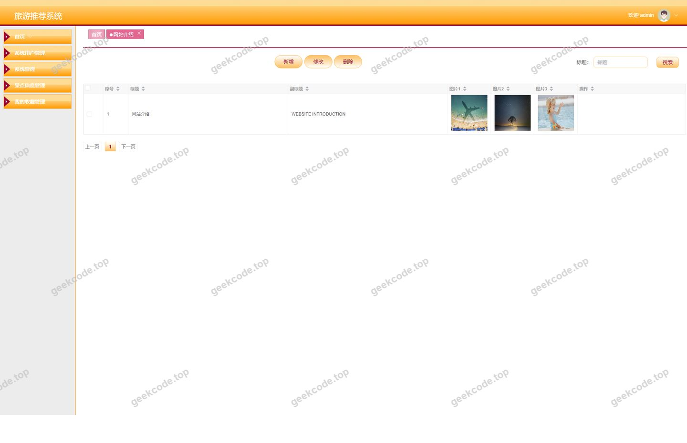
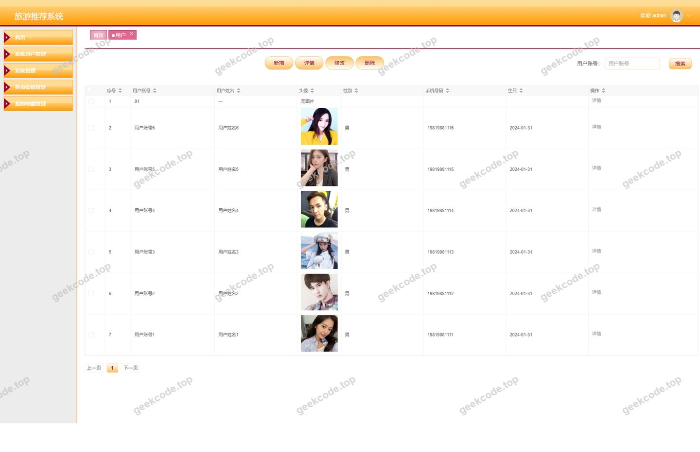

# spring boot 协同过滤算法 旅游推荐系统

> 🎓 **计算机毕业设计 · spring boot 协同过滤算法 旅游推荐系统**
>
> 本仓库只放**项目介绍 + 运行截图**（截图是站点带水印的原图，存在仓库 `images/` 里）。
>
> 👉 **完整可运行源码 / 数据库脚本 / 部署文档：[点我获取](https://geekcode.top/archives/spring-boot-%E5%8D%8F%E5%90%8C%E8%BF%87%E6%BB%A4%E7%AE%97%E6%B3%95-%E6%97%85%E6%B8%B8%E6%8E%A8%E8%8D%90%E7%B3%BB%E7%BB%9F?utm_source=github)**
>
> 💬 咨询微信：**ir9372**　|　🌐 更多项目：[极客代码 geekcode.top](https://geekcode.top/?utm_source=github)
>
> 📌 项目详情页：<https://geekcode.top/archives/spring-boot-%E5%8D%8F%E5%90%8C%E8%BF%87%E6%BB%A4%E7%AE%97%E6%B3%95-%E6%97%85%E6%B8%B8%E6%8E%A8%E8%8D%90%E7%B3%BB%E7%BB%9F?utm_source=github>

<table><td width="230" align="center"> <b>扫码加微信 ir9372</b></td><td valign="middle">📦 源码 = 项目介绍 + 全部运行截图 + 数据库 + 部署文档 👉 点上方任意截图，直接跳到 <b>极客代码 geekcode.top</b> 详情页</td></table>

---

<h1>spring boot 协同过滤算法 旅游推荐系统</h1>
<h2>项目概述</h2>

本项目为基于 Spring Boot 与 Vue 前后端分离架构的旅游推荐系统，核心采用协同过滤算法为用户提供个性化的景点推荐服务。系统旨在解决传统旅游平台信息过载、用户难以快速发现符合个人偏好景点的痛点。主要功能涵盖景点信息管理、分类浏览、资讯发布、用户评论互动及收藏管理等模块。适用人群包括普通游客（前台用户）和平台运营人员（后台管理员）。技术架构上，后端使用 Spring Boot 结合 MyBatis-Plus 实现数据持久化，Shiro 框架保障系统安全；前端采用 Vue.js 构建响应式界面。通过该系统的部署，能够有效提升旅游信息的检索效率与用户体验，实现“千人千面”的智能推荐场景。

<h2>技术架构</h2>
<h3>1. 总体架构设计</h3>

本项目采用经典的前后端分离开发模式。前端负责页面渲染与用户交互，通过 HTTP/HTTPS 协议向后端发起 API 请求；后端负责业务逻辑处理、数据校验及持久化存储，返回 JSON 格式的数据。这种架构降低了前后端耦合度，提升了系统的可维护性与扩展性。

<h3>2. 核心技术选型</h3>
<ul>
<li><strong>后端框架</strong>：选用 <code>Spring Boot</code> 作为基础框架，利用其自动配置特性简化开发流程，内置 Tomcat 容器便于独立部署。</li>
<li><strong>ORM 层</strong>：集成 <code>MyBatis-Plus</code>，在保留 MyBatis 灵活 SQL 编写能力的同时，提供了通用的 CRUD 接口和分页插件，大幅减少样板代码，提升开发效率。</li>
<li><strong>安全框架</strong>：采用 <code>Apache Shiro</code> 进行权限控制与身份认证。Shiro 轻量级且易于集成，能够灵活处理用户登录状态管理及资源访问控制。</li>
<li><strong>数据库</strong>：使用 <code>MySQL</code> 关系型数据库存储用户信息、景点数据、评论记录等结构化数据。</li>
<li><strong>前端技术</strong>：基于 <code>Vue.js</code> 生态构建单页应用（SPA），配合路由管理实现页面跳转与组件复用。</li>
</ul>
<h3>3. 数据库设计要点</h3>

数据库设计遵循第三范式，确保数据一致性。主要实体包括用户表、景点信息表、景点分类表、评论表、收藏表及系统配置表。各表之间通过外键或逻辑关联建立联系，例如景点信息表通过分类 ID 关联至景点分类表，评论表通过用户 ID 和景点 ID 分别关联至用户表和景点信息表，以支持多维度的查询与统计分析。

<h2>功能模块</h2>

根据提供的路由信息与截图，系统功能划分为前台用户端与后台管理端两大部分。

<h3>1. 前台用户端</h3>

前台面向注册用户与普通访客，提供浏览、搜索、互动及个人中心管理功能。

<table>
<thead>
<tr>
<th align="left">模块名称</th>
<th align="left">路由路径</th>
<th align="left">功能描述</th>
</tr>
</thead>
<tbody><tr>
<td align="left"><strong>首页与资讯</strong></td>
<td align="left"><code>/index/newsList</code></td>
<td align="left">展示最新旅游资讯列表，用户可查看新闻详情，获取目的地动态信息。</td>
</tr>
<tr>
<td align="left"><strong>用户管理</strong></td>
<td align="left"><code>/index/yonghuList</code>, <code>/index/yonghuDetail</code>, <code>/index/yonghuAdd</code>, <code>/index/yonghuCenter</code></td>
<td align="left">包含用户注册、个人信息查看、资料修改及个人中心入口。支持用户自主维护基本信息。</td>
</tr>
<tr>
<td align="left"><strong>景点分类浏览</strong></td>
<td align="left"><code>/index/jingdianfenleiList</code>, <code>/index/jingdianfenleiDetail</code>, <code>/index/jingdianfenleiAdd</code></td>
<td align="left">展示景点分类列表，用户可按类别筛选景点，查看分类详情。注：虽然存在 Add 路由，但通常由后台创建，前台可能仅用于特定场景下的新增申请或测试功能。</td>
</tr>
<tr>
<td align="left"><strong>景点信息展示</strong></td>
<td align="left"><code>/index/jingdianxinxiList</code>, <code>/index/jingdianxinxiDetail</code>, <code>/index/jingdianxinxiAdd</code></td>
<td align="left">核心模块，展示景点详细信息（如图片、描述、价格等）。支持按条件搜索景点，查看单个景点详情。同样存在 Add 路由，需结合具体业务逻辑确认是否开放给普通用户投稿。</td>
</tr>
<tr>
<td align="left"><strong>收藏管理</strong></td>
<td align="left"><code>/index/storeupList</code></td>
<td align="left">用户可查看自己收藏的景点列表，方便后续回访或计划行程。</td>
</tr>
<tr>
<td align="left"><strong>网站介绍</strong></td>
<td align="left"><code>/index/systemintroList</code>, <code>/index/systemintroDetail</code>, <code>/index/systemintroAdd</code></td>
<td align="left">展示平台简介、联系方式等信息，增强用户对平台的信任感。</td>
</tr>
<tr>
<td align="left"><strong>评论互动</strong></td>
<td align="left"><em>(隐含在景点详情页)</em></td>
<td align="left">依据后台有评论管理路由推断，前台景点详情页应包含评论发表与展示功能，允许用户对景点进行评价。</td>
</tr>
<tr>
<td align="left"><strong>注册登录</strong></td>
<td align="left"><code>/yonghuRegister</code></td>
<td align="left">新用户注册入口，填写必要信息完成账号创建。</td>
</tr>
</tbody></table>
<h3>2. 后台管理端</h3>

后台面向管理员，提供全量数据的增删改查及系统配置功能。

<table>
<thead>
<tr>
<th align="left">模块名称</th>
<th align="left">路由路径</th>
<th align="left">功能描述</th>
</tr>
</thead>
<tbody><tr>
<td align="left"><strong>系统登录</strong></td>
<td align="left"><code>/login</code> (隐含)</td>
<td align="left">管理员身份验证入口，基于 Shiro 进行权限校验。</td>
</tr>
<tr>
<td align="left"><strong>首页仪表盘</strong></td>
<td align="left"><code>/index</code> (隐含)</td>
<td align="left">展示关键数据统计或快捷操作入口。</td>
</tr>
<tr>
<td align="left"><strong>景点分类管理</strong></td>
<td align="left"><code>/jingdianfenlei</code></td>
<td align="left">对景点分类进行增加、删除、修改、查询操作，维护分类体系结构。</td>
</tr>
<tr>
<td align="left"><strong>景点信息管理</strong></td>
<td align="left"><code>/jingdianxinxi</code></td>
<td align="left">核心数据管理模块，管理员可录入新景点、编辑现有景点信息、下架违规内容或删除过期数据。</td>
</tr>
<tr>
<td align="left"><strong>评论管理</strong></td>
<td align="left"><code>/discussjingdianxinxi</code></td>
<td align="left">审核与管理用户对景点发表的评论，支持删除不良言论或回复用户疑问。</td>
</tr>
<tr>
<td align="left"><strong>用户管理</strong></td>
<td align="left"><code>/yonghu</code></td>
<td align="left">查看注册用户列表，可对异常账号进行禁用、重置密码或删除操作。</td>
</tr>
<tr>
<td align="left"><strong>收藏管理</strong></td>
<td align="left"><code>/storeup</code></td>
<td align="left">查看所有用户的收藏记录，分析热门景点趋势。</td>
</tr>
<tr>
<td align="left"><strong>资讯管理</strong></td>
<td align="left"><code>/news</code></td>
<td align="left">发布、编辑和管理旅游资讯文章，确保内容时效性。</td>
</tr>
<tr>
<td align="left"><strong>网站介绍管理</strong></td>
<td align="left"><code>/systemintro</code></td>
<td align="left">维护前台展示的网站介绍内容，如关于我们、服务条款等。</td>
</tr>
<tr>
<td align="left"><strong>系统配置</strong></td>
<td align="left"><code>/config</code></td>
<td align="left">管理系统基础参数，如轮播图设置、站点名称、Logo 上传等全局配置项。</td>
</tr>
<tr>
<td align="left"><strong>管理员账户</strong></td>
<td align="left"><code>/users</code></td>
<td align="left">管理平台内部管理员账号，支持多角色或多管理员分配（若系统设计支持）。</td>
</tr>
</tbody></table>
<h2>用户角色与权限</h2>

本系统主要涉及两类用户角色：<strong>普通用户（游客）</strong> 和 <strong>管理员</strong>。

<h3>1. 普通用户 (User)</h3>
<ul>
<li><strong>定义</strong>：通过前台注册页面 (<code>/yonghuRegister</code>) 创建账号的个体。</li>
<li><strong>权限范围</strong>：</li>
<li><strong>浏览权限</strong>：可访问所有公开的前台页面，包括首页、资讯列表、景点分类、景点详情、网站介绍。</li>
<li><strong>互动权限</strong>：可在景点详情页发表评论；可将感兴趣的景点加入收藏夹 (<code>/index/storeupList</code>)。</li>
<li><strong>自我管理</strong>：可查看和修改个人资料 (<code>/index/yonghuCenter</code>)；查看自己的收藏记录。</li>
<li><strong>限制</strong>：无法访问任何后台管理路由 (<code>/admin/*</code>)；无法直接修改其他用户数据或系统配置。</li>
</ul>
<h3>2. 管理员 (Admin)</h3>
<ul>
<li><strong>定义</strong>：拥有系统最高权限的运维人员，通过后台登录页进入系统。</li>
<li><strong>权限范围</strong>：</li>
<li><strong>数据全面管控</strong>：对景点信息、景点分类、资讯、网站介绍拥有完整的 CRUD（增删改查）权限。</li>
<li><strong>内容审核</strong>：管理所有用户的评论，具备删除违规评论的权利。</li>
<li><strong>用户管理</strong>：查看用户列表，对用户账号状态进行管理。</li>
<li><strong>系统配置</strong>：修改全局系统参数，管理后台管理员账户。</li>
<li><strong>数据监控</strong>：通过后台首页或各列表页查看整体运营数据。</li>
</ul>
<h2>项目特色与创新点</h2>
<ol>
<li><strong>协同过滤算法应用</strong>：项目名称明确指出使用了“协同过滤算法”。这意味着系统不仅仅是静态的信息展示，而是能够基于用户的历史行为（如浏览、收藏、评分）计算相似度，从而向目标用户推荐可能感兴趣的景点。这是区别于传统旅游 CMS 的核心智能特征。</li>
<li><strong>前后端分离的高效体验</strong>：采用 Vue + Spring Boot 架构，实现了页面的无刷新局部更新，提升了用户在浏览大量景点图片和信息时的流畅度，同时也便于移动端适配和未来功能扩展。</li>
<li><strong>完善的社区互动机制</strong>：集成了评论系统和收藏功能，构建了“看-评-藏”的用户闭环。收藏数据不仅方便用户个人规划，也为协同过滤算法提供了重要的隐式反馈数据源，形成数据驱动的良性循环。</li>
<li><strong>模块化后台管理</strong>：后台将景点、分类、资讯、用户、评论等解耦为独立的管理模块，职责清晰，便于多人协作维护和权限细化控制。</li>
</ol>
<h2>部署环境</h2>

为确保系统正常运行，需准备以下软件环境：

<table>
<thead>
<tr>
<th align="left">组件</th>
<th align="left">版本建议</th>
<th align="left">说明</th>
</tr>
</thead>
<tbody><tr>
<td align="left"><strong>JDK</strong></td>
<td align="left">1.8 或更高</td>
<td align="left">Java 运行环境，Spring Boot 依赖 JDK 编译和运行。</td>
</tr>
<tr>
<td align="left"><strong>Maven</strong></td>
<td align="left">3.6+</td>
<td align="left">项目构建工具，用于管理依赖包和打包部署。</td>
</tr>
<tr>
<td align="left"><strong>MySQL</strong></td>
<td align="left">5.7 或 8.0</td>
<td align="left">关系型数据库，存储业务数据。需初始化数据库脚本。</td>
</tr>
<tr>
<td align="left"><strong>Node.js</strong></td>
<td align="left">LTS 版本 (如 v14+)</td>
<td align="left">前端构建环境，用于安装 npm 依赖及编译 Vue 代码。</td>
</tr>
<tr>
<td align="left"><strong>IDE</strong></td>
<td align="left">IntelliJ IDEA / VS Code</td>
<td align="left">开发工具，后端推荐使用 IDEA，前端推荐使用 VS Code。</td>
</tr>
<tr>
<td align="left"><strong>浏览器</strong></td>
<td align="left">Chrome / Edge</td>
<td align="left">现代浏览器，用于访问前端页面。</td>
</tr>
</tbody></table>

<strong>部署步骤简述</strong>：

<ol>
<li>导入 MySQL 数据库文件，创建 schema。</li>
<li>修改后端 <code>application.yml</code> 配置文件，指向正确的数据库地址、用户名和密码。</li>
<li>使用 Maven 命令 <code>mvn clean package</code> 打包后端 jar 包并运行。</li>
<li>进入前端目录，执行 <code>npm install</code> 安装依赖，随后执行 <code>npm run build</code> 生成静态资源，或直接运行 <code>npm run serve</code> 进行本地调试。</li>
</ol>
<h2>五、技术特性</h2>
<ul>
<li>前后端分离架构，前端独立部署</li>
<li>使用 MyBatis-Plus 简化数据访问层开发</li>
<li>集成 Shiro 权限框架实现角色权限控制</li>
</ul>
<h2>六、功能模块截图</h2>
<h3>后台管理端</h3>
<h4>后台-登录页</h4>

<h4>后台-景点分类</h4>

<h4>后台-景点信息</h4>

<h4>后台-景点信息评论</h4>

<h4>后台-景点资讯</h4>

<h4>页面-首页</h4>

<h4>后台-网站介绍</h4>

<h4>后台-用户</h4>

---

## 获取完整源码

| 项目 | 说明 |
| --- | --- |
| 项目名 | spring boot 协同过滤算法 旅游推荐系统 |
| 运行截图 | 本文 8 张（站点带水印原图，仓库 `images/` 目录） |
| 完整源码 | [https://geekcode.top/archives/spring-boot-%E5%8D%8F%E5%90%8C%E8%BF%87%E6%BB%A4%E7%AE%97%E6%B3%95-%E6%97%85%E6%B8%B8%E6%8E%A8%E8%8D%90%E7%B3%BB%E7%BB%9F?utm_source=github](https://geekcode.top/archives/spring-boot-%E5%8D%8F%E5%90%8C%E8%BF%87%E6%BB%A4%E7%AE%97%E6%B3%95-%E6%97%85%E6%B8%B8%E6%8E%A8%E8%8D%90%E7%B3%BB%E7%BB%9F?utm_source=github) |
| 咨询微信 | **ir9372**（备注：jingpin-yuanma） |
| 更多项目 | [极客代码 geekcode.top](https://geekcode.top/?utm_source=github) |

> 需要源码、部署、改配置、跑不起来等问题，加微信 ir9372 沟通，说明项目名即可。
